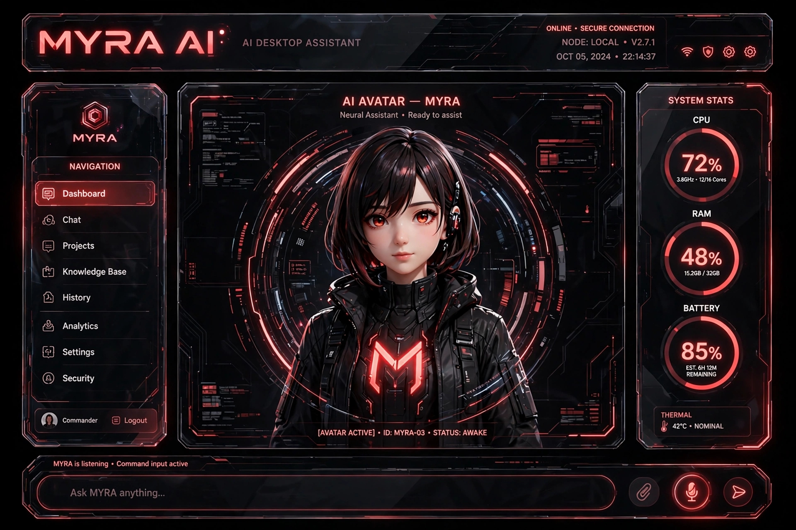

<div align="center">

# 🤖 MYRA AI - Your Smart PC Assistant

**MYRA (My Real-time AI)** is a futuristic, JARVIS-inspired desktop AI assistant for Windows. It combines a stunning 2D/3D user interface, real-time system monitoring, and an advanced A to Z voice command system, all powered by top-tier AI brains like Groq (Llama 3) and Google Gemini.

[](https://github.com/mobeen786mughal-ux/Myra-AI/releases)
[](https://github.com/mobeen786mughal-ux/Myra-AI/actions)
[](https://opensource.org/licenses/MIT)

<br />

<!-- YAHAN AAPKI TASVEER LAGEGI (JPG format) -->


<br /><br />

</div>

---

## ✨ Key Features

### 🎙️ A to Z Voice Commands
Control your PC without touching the keyboard! Just click the Mic and speak:
- *"Open Chrome"*, *"Lock my PC"*, *"Take a screenshot"*, *"Shutdown"*, *"Volume up"*, etc.
- Natural Language Processing means you can also just talk to it like a human.

### 🧠 Dual AI Brain (Bring Your Own Key)
- **Groq (Llama 3.3 70B):** Ultra-fast responses for real-time conversations.
- **Google Gemini:** Deep reasoning and complex task handling.
- *Note: You can switch between them in Settings.*

### 🎭 2D & 3D Avatars
- Toggle between a high-quality **2D Anime Avatar** and an interactive **3D VRM/GLB Model**.
- All assets load 100% **offline** from your local storage.

### 🖥️ Real-Time System Stats
- Live CPU usage, RAM consumption, CPU Temperature, and Battery level right on your dashboard.

### ⚡ 50+ Quick Tools & Automation
- **System:** Shutdown, Restart, Lock, Sleep, Empty Recycle Bin, Task Manager.
- **Apps:** Open Chrome, VS Code, Notepad, Calculator, CMD, WhatsApp.
- **Media:** Play/Pause, Next Track, Volume Control.
- **AI Productivity:** Weather, News, Jokes, Summarize, Translate, Write Email.

### 🛡️ Background Mode (System Tray)
- Clicking 'X' doesn't close the app; it hides in the System Tray. 
- Access MYRA anytime from the taskbar.

---

## 🚀 How to Install & Run (For Users)

You don't need to install any coding software. We have automated the build process using GitHub Actions!

1. Go to the **[Releases](https://github.com/mobeen786mughal-ux/Myra-AI/releases)** section of this repository.
2. Download the latest **`MYRA AI Setup.exe`**.
3. Run the installer and open MYRA.
4. Click the **⚙️ Settings** icon (top right).
5. Enter your **Groq** or **Gemini API Key** and save. *(You can get a free key from [Groq Console](https://console.groq.com/) or [Google AI Studio](https://aistudio.google.com/))*.
6. Click the **Mic** icon and start talking!

---

## 🛠️ Tech Stack

- **Frontend:** React.js, Vite, Tailwind CSS, Lucide Icons
- **3D Engine:** Three.js, React Three Fiber
- **Backend:** Node.js, Express.js, SystemInformation
- **Desktop App:** Electron.js, Electron-Builder
- **AI Integration:** Groq API, Google Gemini API
- **Automation:** GitHub Actions (CI/CD for Auto-EXE Generation)

---

## 🧑‍💻 Local Development (For Developers)

Want to run the source code and contribute? Follow these steps:

### 1. Clone the Repository
```bash
git clone https://github.com/mobeen786mughal-ux/Myra-AI.git
cd Myra-AI
